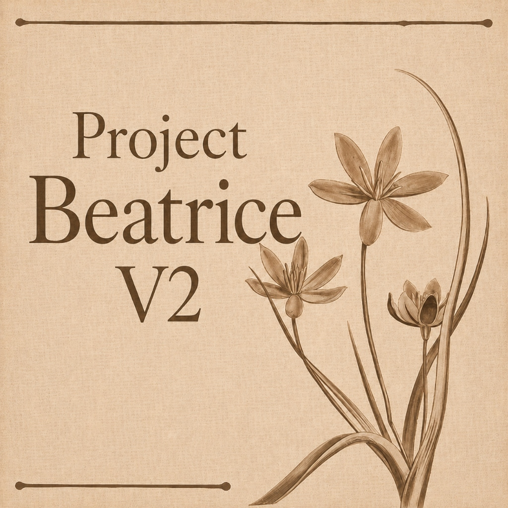
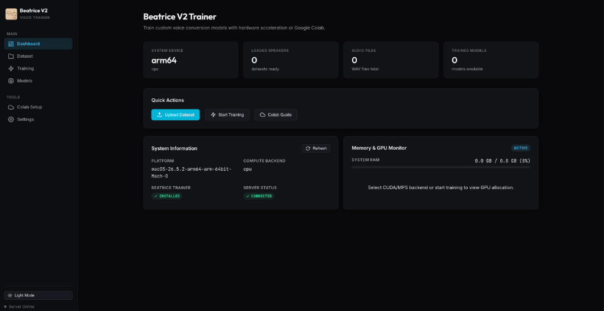
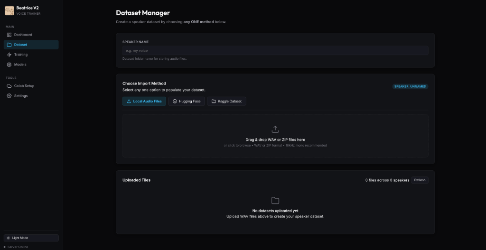
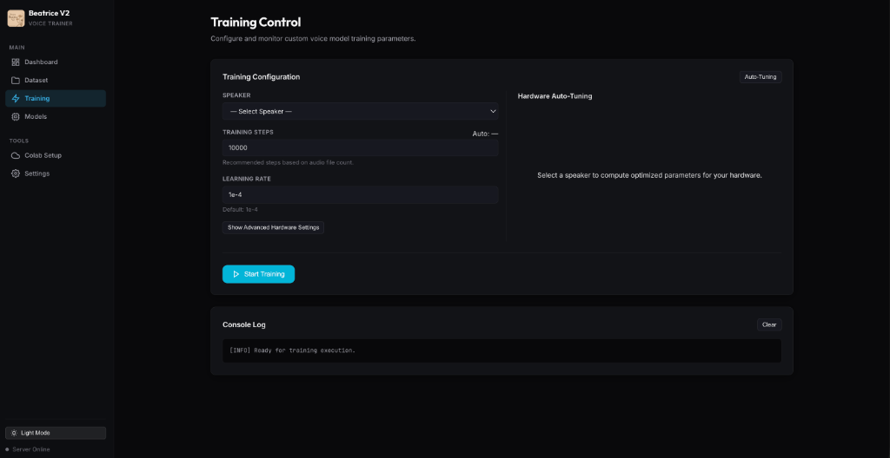
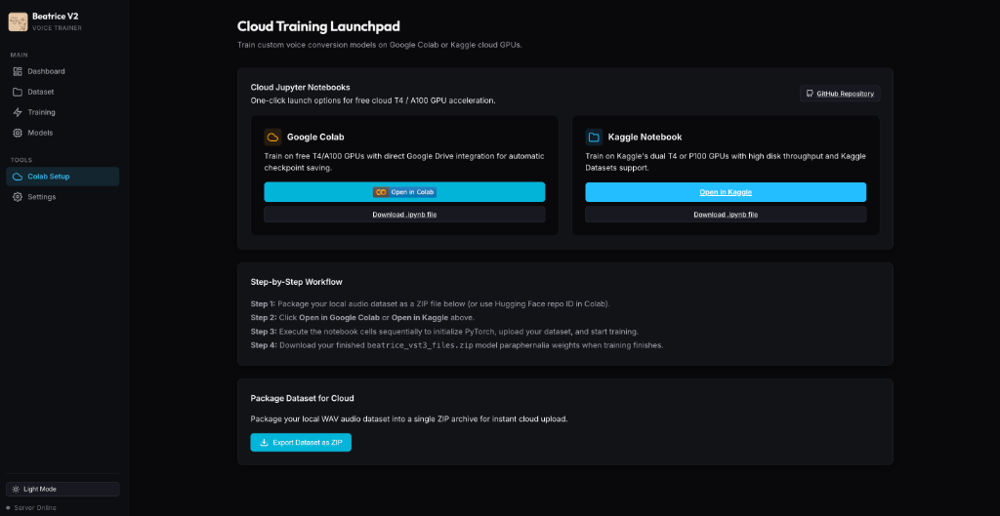

<p align="center">
  
</p>

# Project Beatrice V2 Voice Trainer (Windows & Cross-Platform)

[](#)
[](#)
[](#)
[](#)
[](#)

A high-performance, hardware-aware desktop Web application for training custom real-time voice conversion models using **Project Beatrice V2**. Featuring a modern **Cyan Blue minimalist UI**, dynamic **Light/Dark theme toggle**, **Single-Choice Dataset Import Switcher** (Local Drop-Zone, Hugging Face, Kaggle), automated **NVIDIA GPU CUDA Hardware Tuning**, and direct **Google Colab & Kaggle Cloud Launchpad** integration.

---

## ✨ Key Features

* 💎 **Cyan Blue Minimalist UI & Vector SVGs** — Ultra-sleek Linear/Vercel-inspired desktop design system with custom vector SVG icons and sharp typography (`Inter`, `Outfit`, `JetBrains Mono`).
* 🌓 **Light & Dark Mode Theme Switcher** — Instant theme switching with persistent user preferences stored in local storage (`localStorage`).
* 🎯 **Single-Choice Dataset Import Selector** — Segmented method picker allowing users to easily choose between **Local Audio Upload**, **Hugging Face Import**, or **Kaggle Dataset Import**.
* ⚡ **NVIDIA CUDA Hardware Tuning** — Deep profiling for NVIDIA GPUs (RTX 4090, 4080, 4070, 3090, 3080, 3060, 2060, etc.) and Apple Silicon MPS with automatic batch size and worker optimization.
* ☁️ **Cloud Training Launchpad** — Direct integration of `Project-Beatrice-V2/Beatrice-colab` with one-click **Google Colab** (`.ipynb`) and **Kaggle** launch buttons and local notebook downloads.
* 📈 **Real-Time Monitoring & Metrics** — Live loss plotting on HTML Canvas, stdout logging console, and memory usage gauges.

---

## 🖼️ Interface Showcase

<p align="center">
  
  <br><sub><b>Dashboard Overview</b> — Live hardware monitor, memory allocation gauges, and system diagnostics</sub>
</p>

<p align="center">
  
  <br><sub><b>Dataset Manager</b> — Single-choice import selector (Local Audio Drag & Drop, Hugging Face, Kaggle)</sub>
</p>

<p align="center">
  
  <br><sub><b>Training Control</b> — Hardware auto-tuning, custom training steps, and live console logger</sub>
</p>

<p align="center">
  
  <br><sub><b>Cloud Training Launchpad</b> — One-click Google Colab and Kaggle launch cards with local .ipynb downloads</sub>
</p>

---

## ⚡ Quick Start

### 📋 Prerequisites

* **Operating System**: Windows 10 or Windows 11 (64-bit) / macOS 12+ / Linux.
* **GPU**: NVIDIA GPU with CUDA support recommended (e.g., RTX 2060+, 3060+, 4060+). CPU fallback is supported.
* **Python**: Python 3.10 or newer (make sure to check *"Add python.exe to PATH"* during installation).

### 💻 One-Click Execution

Double-click `start_windows.bat` (or `start.bat`) in File Explorer, or run in Command Prompt / PowerShell:

```cmd
start_windows.bat
```

*For macOS / Linux systems:*
```bash
chmod +x start.sh
./start.sh
```

#### What the Startup Script Automates:
1. Creates a local Python virtual environment (`venv/`).
2. Installs CUDA-accelerated PyTorch (`torch` and `torchaudio` using the CUDA 12.1 wheel index).
3. Installs backend dependencies (`fastapi`, `uvicorn`, `python-multipart`, `aiofiles`, `huggingface_hub`, `psutil`).
4. Downloads the core **Beatrice Trainer** repository from Hugging Face (`fierce-cats/beatrice-trainer`).
5. Launches the FastAPI backend server and automatically opens your browser at **`http://localhost:8000`**.

---

## 🎮 Hardware Auto-Tuning Matrix

When selecting a speaker dataset in the **Training** tab, the system profiles hardware to compute optimal hyperparameters:

| Hardware Tier | GPU / VRAM | Batch Size | Grad Accum | Effective Batch | Workers | Mixed Precision |
| :--- | :--- | :---: | :---: | :---: | :---: | :---: |
| **Ultra Enthusiast** | RTX 3090 / 4090 (24GB) | 16 | 1 | 16 | 4 | Enabled (FP16) |
| **High Performance** | RTX 4080 / 3080 Ti (16GB) | 8 | 2 | 16 | 4 | Enabled (FP16) |
| **Standard Gaming** | RTX 3060 / 4070 (12GB) | 4 | 4 | 16 | 2 | Enabled (FP16) |
| **Entry Level GPU** | RTX 3060 8GB / 4060 (8GB) | 2 | 4 | 8 | 2 | Enabled (FP16) |
| **CPU Fallback** | System CPU | 2 | 4 | 8 | 2 | Disabled |

---

## 📂 Directory Structure

```text
├── assets/                          # App branding and logo assets
│   └── logo.jpg                     # Official Project Beatrice V2 Logo
├── colab_repo/                      # Cloned Beatrice-Colab repository
│   ├── BeatriceV2_Trainer_Notebook_Colab.ipynb
│   └── BeatriceV2_Trainer_Notebook_Kaggle.ipynb
├── app.js                           # Client-side JavaScript application & UI handlers
├── index.html                       # Modern HTML layout & component views
├── index.css                        # Cyan Blue Design System & Light/Dark themes
├── server.py                        # FastAPI backend server & REST endpoints
├── start_windows.bat                # Automated Windows batch startup script
├── start.bat                        # Batch launcher shortcut
├── start.sh                         # Cross-platform shell startup script
├── requirements.txt                 # Backend Python dependencies
├── README.md                        # Documentation manual
└── beatrice-trainer/                # Downloaded Hugging Face trainer files
```

---

## 🌐 API Endpoint Reference

| Endpoint | Method | Description |
| :--- | :---: | :--- |
| `/api/status` | `GET` | System health check & backend availability |
| `/api/system/memory` | `GET` | Live RAM, VRAM, and CPU usage metrics |
| `/api/dataset/list` | `GET` | List available speaker datasets and file counts |
| `/api/dataset/upload` | `POST` | Upload WAV or ZIP audio files |
| `/api/dataset/import/hf` | `POST` | Download dataset directly from Hugging Face |
| `/api/dataset/import/kaggle` | `POST` | Import dataset from Kaggle |
| `/api/train/auto-tune` | `POST` | Compute optimal training hyperparameters |
| `/api/train/start` | `POST` | Launch local model training process |
| `/api/train/stop` | `POST` | Terminate active model training process |
| `/api/models/list` | `GET` | List trained VST3 paraphernalia voice models |

---

## 📄 License

This project is licensed under the [MIT License](LICENSE).
